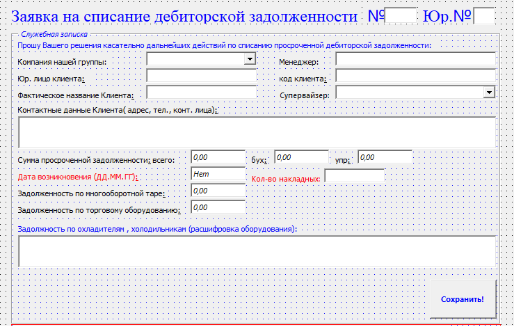
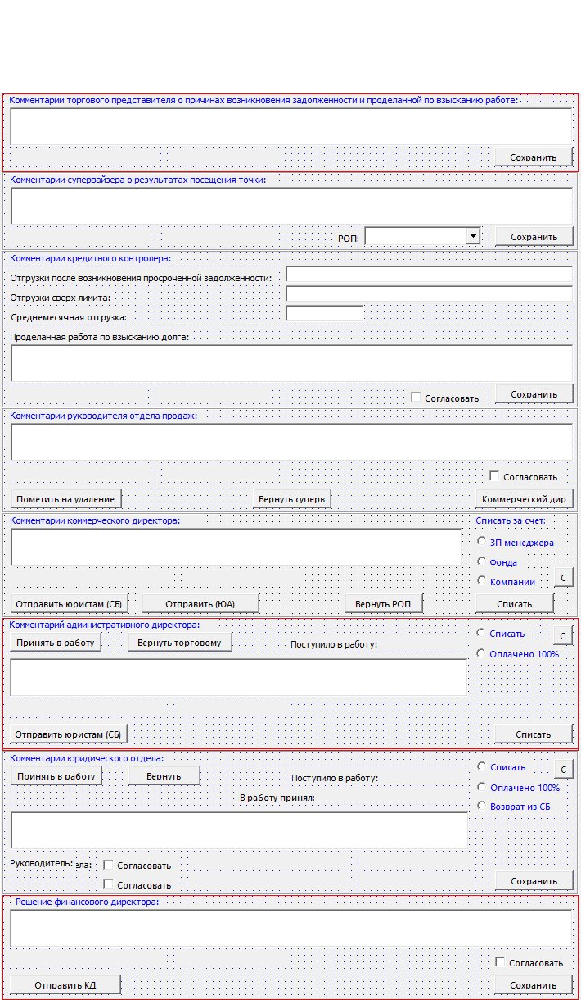

> ### 🏛️ ARCHIVED EXHIBIT / АРХЕОЛОГИЧЕСКИЙ ЭКСПОНАТ
> **EN:** Published exclusively for historical and archaeological purposes. This repository is a museum of legacy admin automation built "on the knee" from whatever Microsoft tools were at hand back in 2013–2017. All workflows have been decommissioned for a long time. The code is preserved for history to show how we squeezed every last drop out of Outlook Public Folders.
>
> **RU:** Выложено исключительно в археологических целях. Данный репозиторий — это музей админской автоматизации «на коленке» из подручных материалов Microsoft эпохи 2013–2017 годов. Все процессы давно выведены из эксплуатации. Код оставлен для истории и демонстрации того, как выжимались последние соки из общих папок Outlook.

---

# Custom Workflow Automation via Outlook Public Folders (Legacy)

## 🛠️ English Version (Project Overview)
This is a collection of legacy scripts and forms I wrote to automate internal approval workflows directly through corporate email. The main goal was to allow managers, legal, and executives to approve business requests inside the Outlook window, eliminating the need for expensive CRM or SharePoint deployments.

### ⚙️ Tech Stack
Built entirely on native Microsoft features:
* **VBScript** — handles all button actions and data validation within the forms.
* **LDAP** — allows the form to query Active Directory and discover who opened it.
* **Scripting.FileSystemObject** — manages simple file-based sequences on a network share.
* **CDO.Message** — handles SMTP notifications.
* **Word.Application (COM)** — automatically generates and prints physical documents.

### 💡 Embedded Admin Tricks & Workarounds
Since a proper SQL server deployment was forbidden by management, the platform used creative workarounds to bypass Outlook limitations:
* **Role-Based Access (RBAC):** On open, the form fetched the user's `sAMAccountName` via LDAP and verified it against a `users.ini` file on a network share. If opened by a sales rep, the fields meant for supervisors or legal were hard-locked.
* **Infinite Loop Protection:** In Outlook, modifying any field triggers an event recursively. To prevent the form from hanging the client machine, global buffer flag variables were introduced (e.g., setting an "Updating" flag, modifying the field, and clearing the flag).
* **Databaseless Auto-Increment IDs:** Request IDs were generated by opening a text file on a network share, counting the total number of lines, adding `+1` for the new ID, and writing it back to the file.
* **Calendar & Word Automation:** If the legal department rejected a request, the script didn't just send an email — it forced a 10-day reminder appointment into the sales rep's Outlook calendar. Clicking "Print" initialized a hidden MS Word instance, mapped fields into a template, and pushed it to the physical printer.

---

# Самописная автоматизация документооборота в общих папках Outlook

## 🛠️ Русская версия (О чем проект)
Это набор скриптов и форм, которые я писал по заказу руководства, чтобы автоматизировать внутренние согласования в компании напрямую через почту. Идея была в том, чтобы менеджеры, юристы и директора не бегали друг к другу, а утверждали заявки прямо в окне Outlook, не тратя деньги на покупку тяжелых CRM или SharePoint.

### 📂 Доступные модули (Что внутри)
1. **Заявка на списание дебиторской задолженности (`Akt_Spis_08e1v4.vbs`):** Форма для торговых представителей, супервайзеров и финдиректора, чтобы списывать или блокировать долги клиентов.
2. *(Остальные модули добавляются постепенно в процессе раскопок архивов).*

### 💡 Как эта магия работала на практике
* **Разграничение прав:** При открытии форма через LDAP запрашивала имя учетки в Active Directory, а потом шла в простой файлик `users.ini` на сетевой шаре. Если ты торговый представитель — скрипт блокировал поля для супервайзера и юристов, чтобы никто не нажал лишнего.
* **Защита от бесконечного зависания формы:** В Outlook изменение любого поля вызывает событие по кругу. Чтобы форма не уходила в бесконечную рекурсию, использовались буферные переменные-флаги. Скрипт ставил флаг «Я обновляюсь», менял поле и снимал флаг.
* **Сквозная нумерация заявок без базы данных:** Скрипт открывал текстовый файл `Number.txt` на сетевой шаре, считал количество строк, прибавлял единицу, выдавал номер новой заявке и дописывал его в файл.
* **Календарь и печать:** Если юристы отклоняли заявку, скрипт принудительно создавал событие-напоминание в календаре Outlook у менеджера. А по кнопке «Печать» форма сама открывала скрытый Word, заполняла шаблон данными из полей и отправляла на принтер.

